# Recursos — Línea de Infraestructura

Recursos y archivos publicados del proyecto.

## Diagramas PNG

- 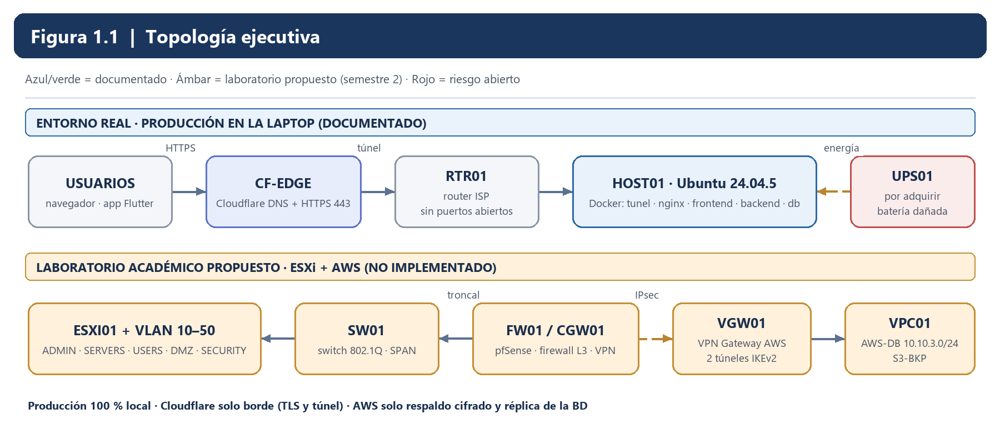
  [:material-download: S1_E1_Fig_1.1.png](diagramas/png/S1_E1_Fig_1.1.png){ .md-button }
- 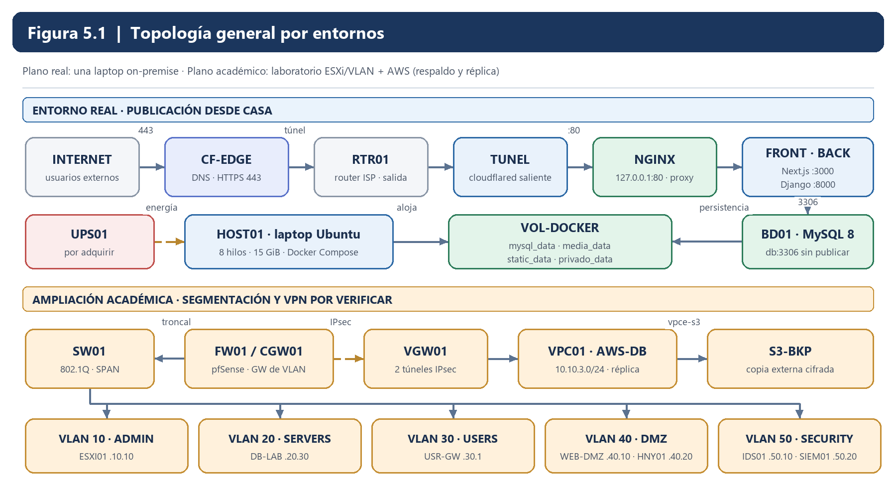
  [:material-download: S1_E1_Fig_5.1.png](diagramas/png/S1_E1_Fig_5.1.png){ .md-button }
- 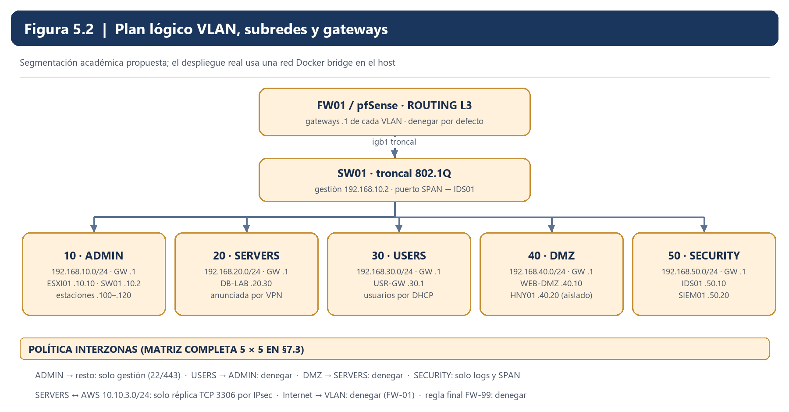
  [:material-download: S1_E1_Fig_5.2.png](diagramas/png/S1_E1_Fig_5.2.png){ .md-button }
- 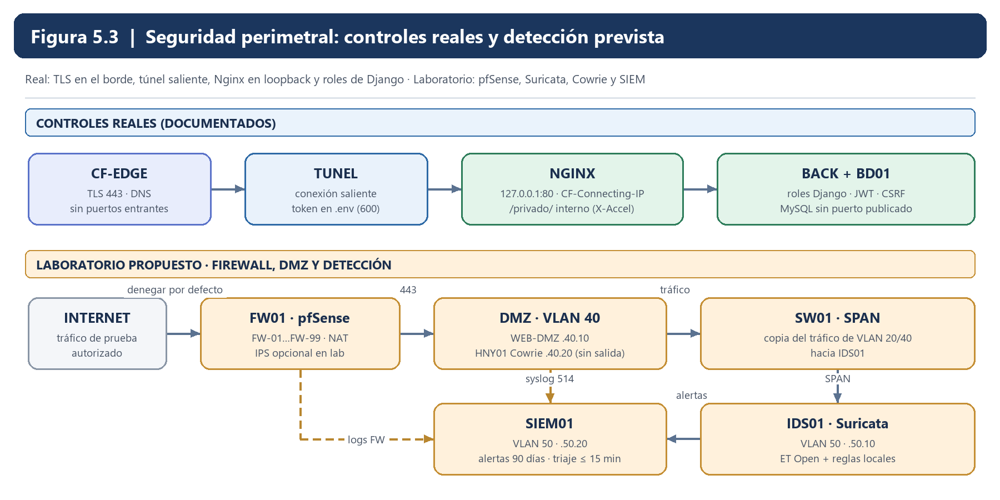
  [:material-download: S1_E1_Fig_5.3.png](diagramas/png/S1_E1_Fig_5.3.png){ .md-button }
- 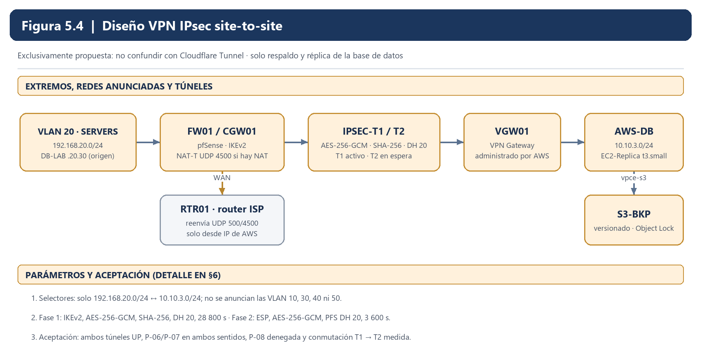
  [:material-download: S1_E1_Fig_5.4.png](diagramas/png/S1_E1_Fig_5.4.png){ .md-button }
- 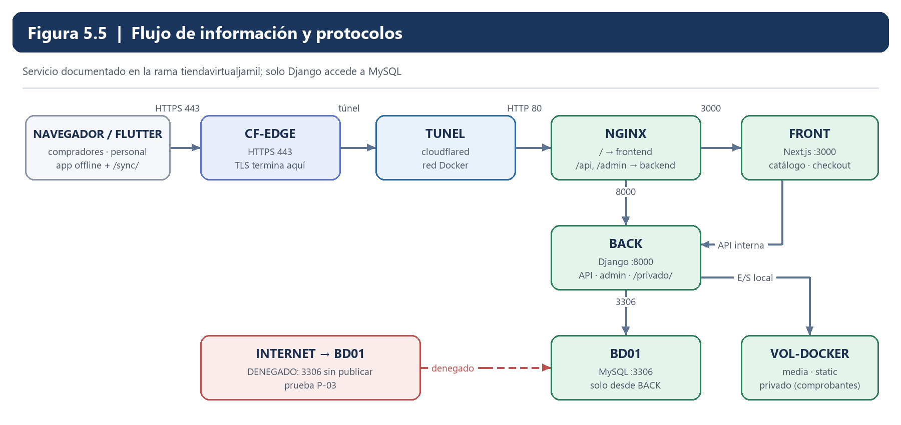
  [:material-download: S1_E1_Fig_5.5.png](diagramas/png/S1_E1_Fig_5.5.png){ .md-button }
- 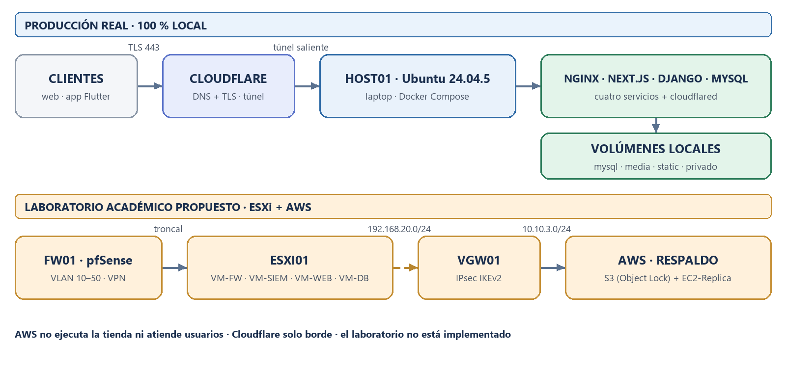
  [:material-download: S1_E2_Fig_1.1.png](diagramas/png/S1_E2_Fig_1.1.png){ .md-button }
- 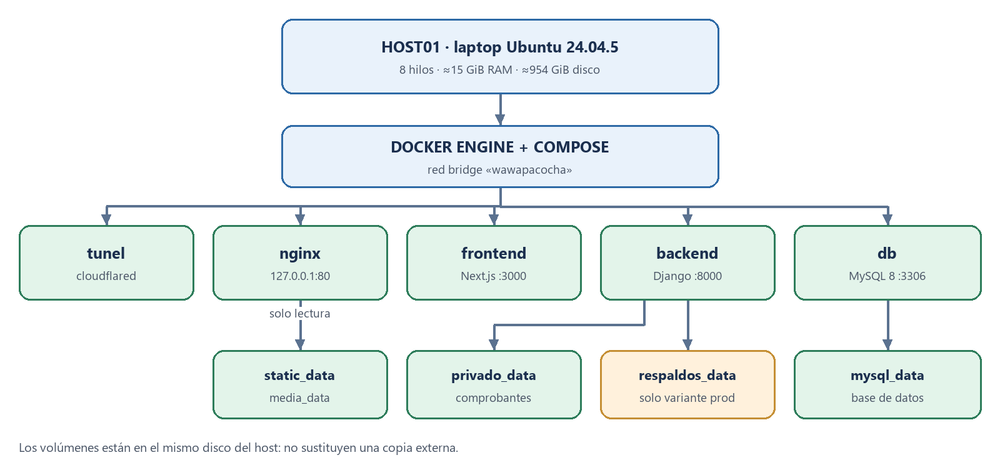
  [:material-download: S1_E2_Fig_2.1.png](diagramas/png/S1_E2_Fig_2.1.png){ .md-button }
- 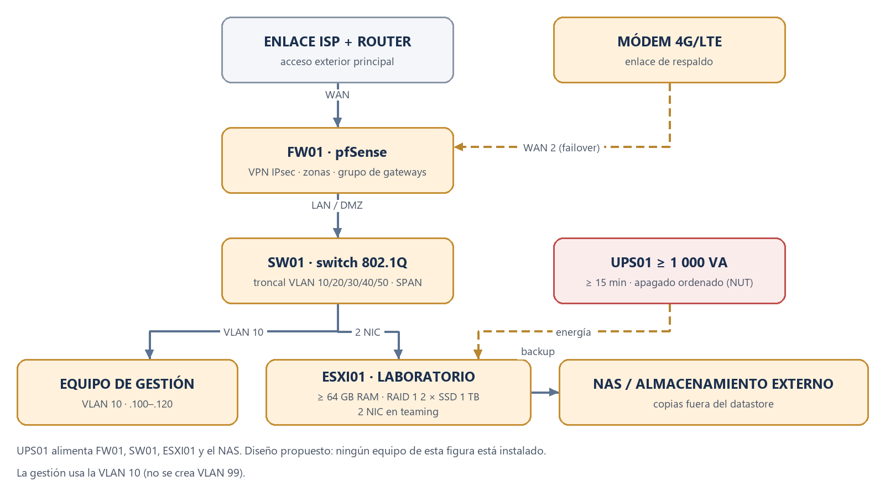
  [:material-download: S1_E2_Fig_5.1.png](diagramas/png/S1_E2_Fig_5.1.png){ .md-button }
- 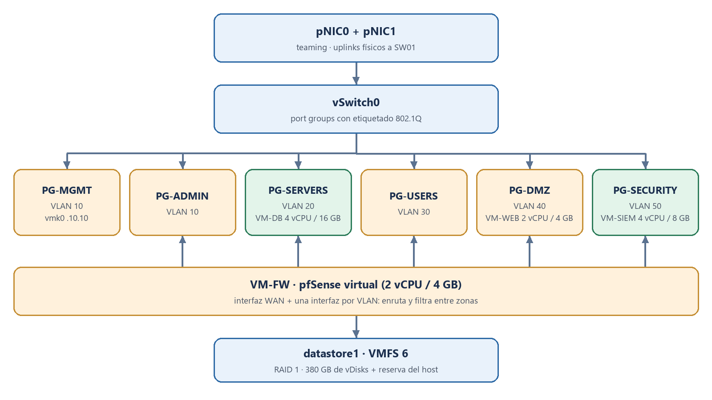
  [:material-download: S1_E2_Fig_5.2.png](diagramas/png/S1_E2_Fig_5.2.png){ .md-button }
- 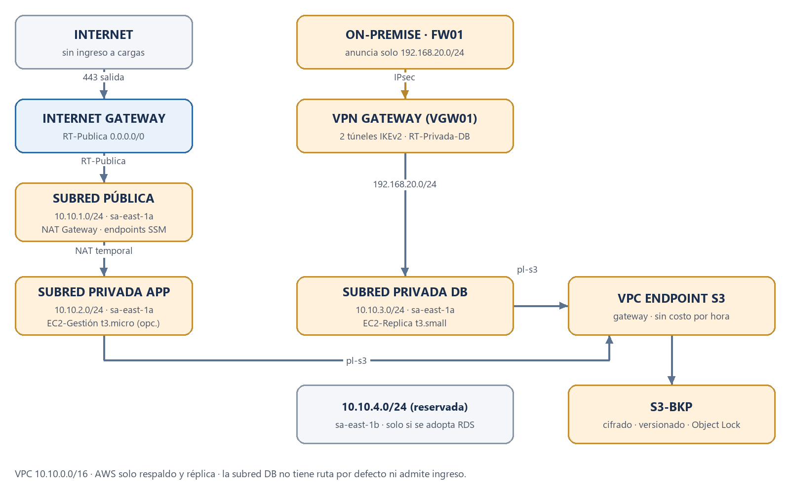
  [:material-download: S1_E2_Fig_6.1.png](diagramas/png/S1_E2_Fig_6.1.png){ .md-button }
- 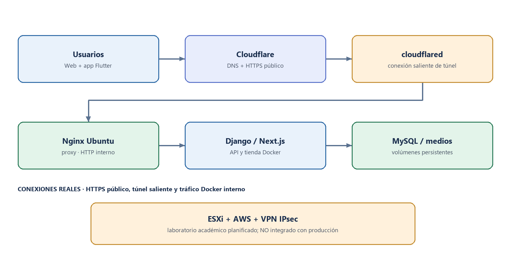
  [:material-download: S2_E1_Fig_3_1_Alcance_del_SGSI.png](diagramas/png/S2_E1_Fig_3_1_Alcance_del_SGSI.png){ .md-button }
- 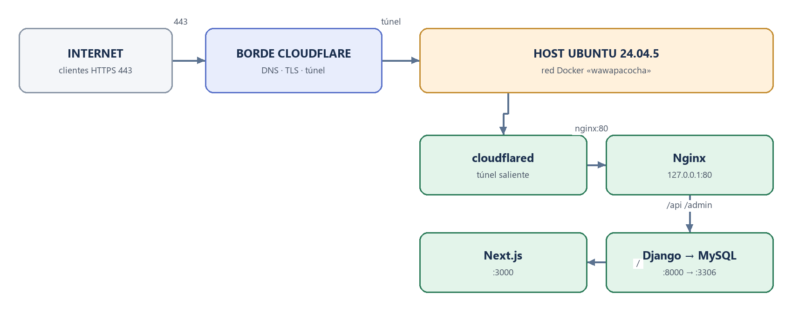
  [:material-download: S2_E2_Fig_2_1_Trafico_publico.png](diagramas/png/S2_E2_Fig_2_1_Trafico_publico.png){ .md-button }
- 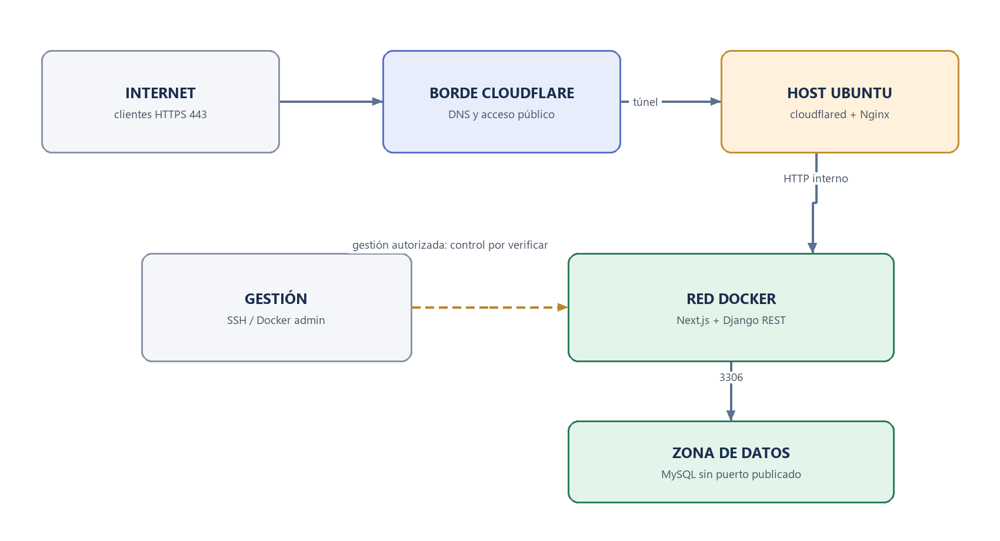
  [:material-download: S2_E2_Fig_4_1_Zonas_de_confianza.png](diagramas/png/S2_E2_Fig_4_1_Zonas_de_confianza.png){ .md-button }
- 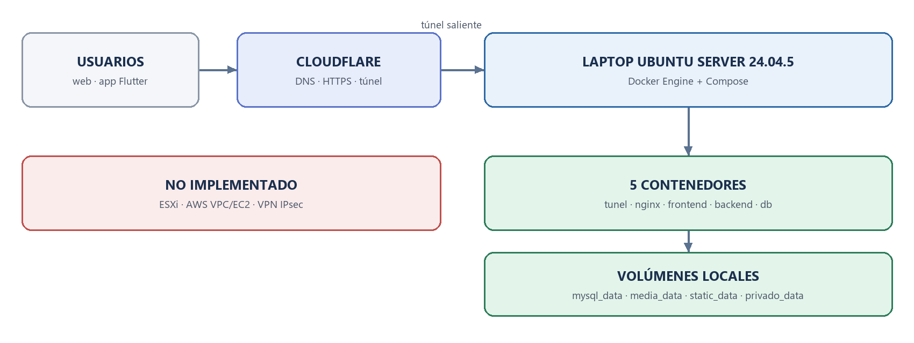
  [:material-download: S2_E3_Fig_1_1_Arquitectura_implementada.png](diagramas/png/S2_E3_Fig_1_1_Arquitectura_implementada.png){ .md-button }
- 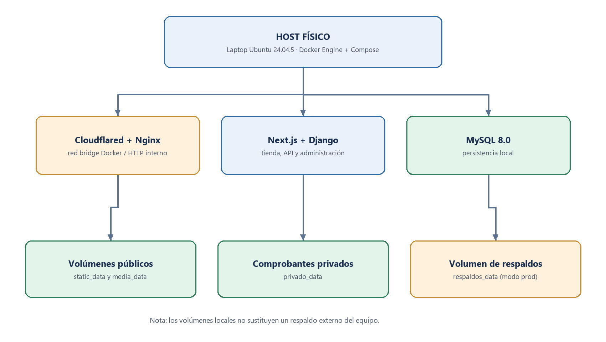
  [:material-download: S2_E3_Fig_3_1_Componentes_y_persistencia.png](diagramas/png/S2_E3_Fig_3_1_Componentes_y_persistencia.png){ .md-button }

## Diagramas fuente (drawio)

- [:material-file: S1_E1_Topologias.drawio](diagramas/S1_E1_Topologias.drawio){ .md-button }
- [:material-file: S1_E2_Topologias.drawio](diagramas/S1_E2_Topologias.drawio){ .md-button }
- [:material-file: S2_E1_Topologias.drawio](diagramas/S2_E1_Topologias.drawio){ .md-button }
- [:material-file: S2_E2_Topologias.drawio](diagramas/S2_E2_Topologias.drawio){ .md-button }
- [:material-file: S2_E3_Topologias.drawio](diagramas/S2_E3_Topologias.drawio){ .md-button }

## Archivos Excel

- [:material-file: S2_E1_Inventario_de_activos.xlsx](entregables_xlsx/S2_E1_Inventario_de_activos.xlsx){ .md-button }
- [:material-file: S2_E1_Matriz_de_riesgos.xlsx](entregables_xlsx/S2_E1_Matriz_de_riesgos.xlsx){ .md-button }
- [:material-file: S2_E1_SoA_93_controles.xlsx](entregables_xlsx/S2_E1_SoA_93_controles.xlsx){ .md-button }
