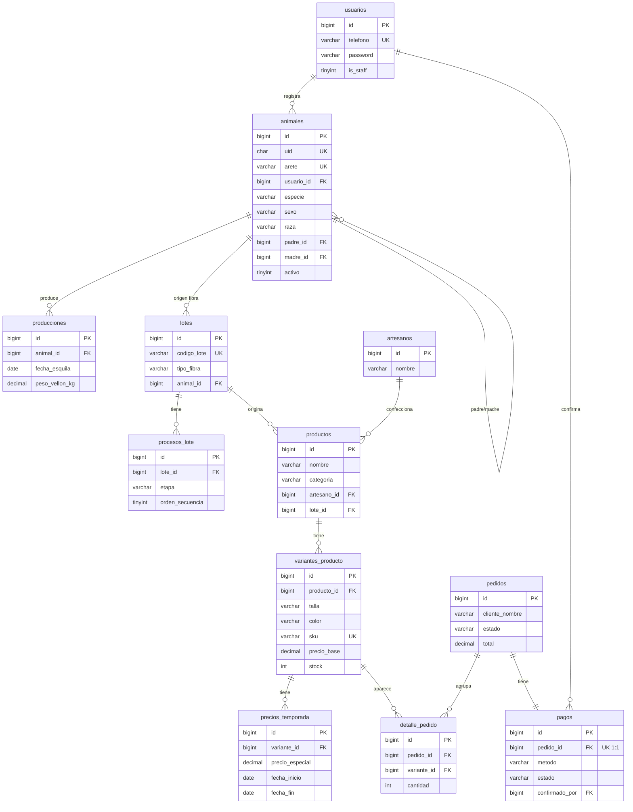
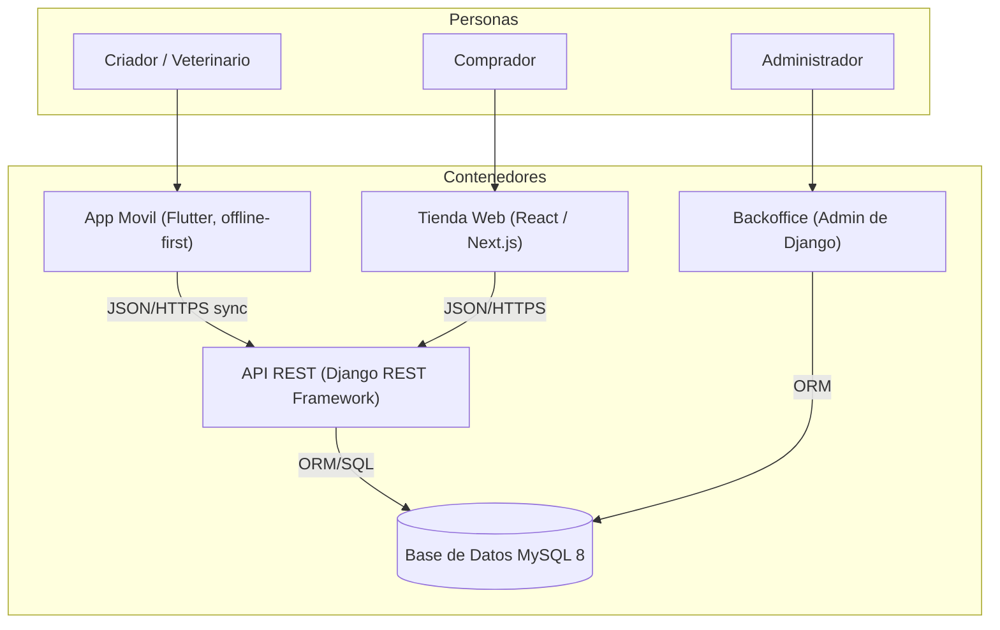
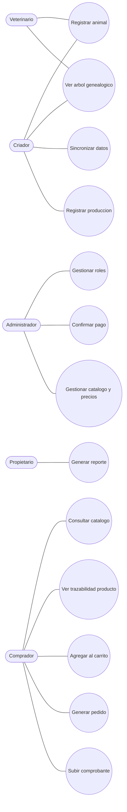
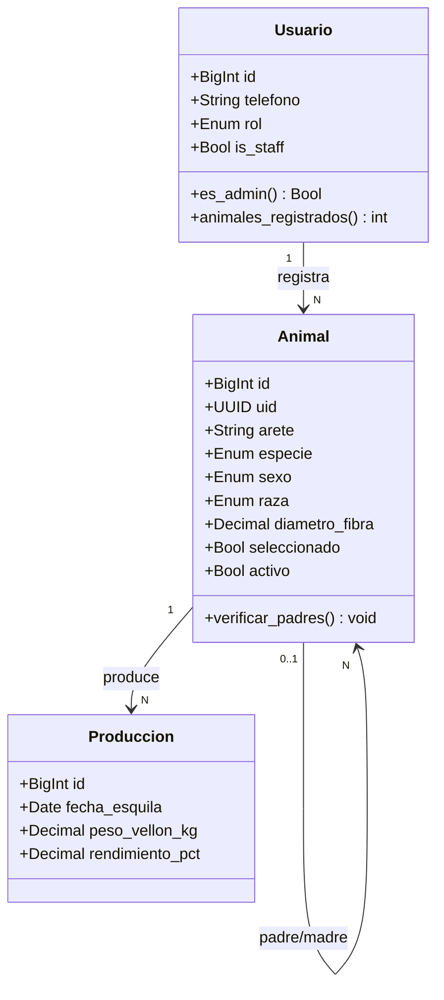
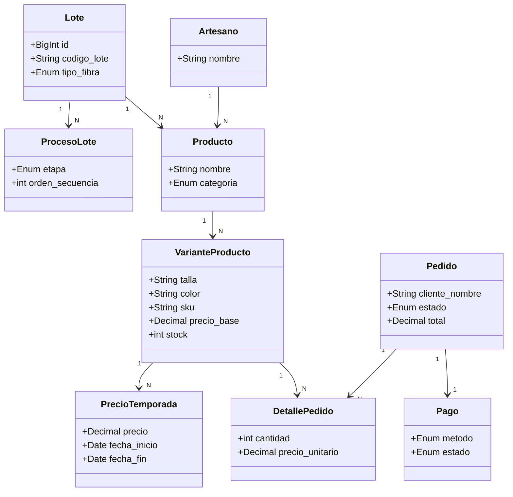
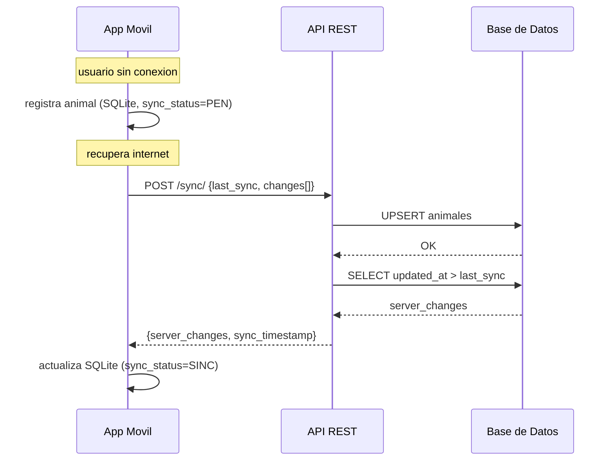
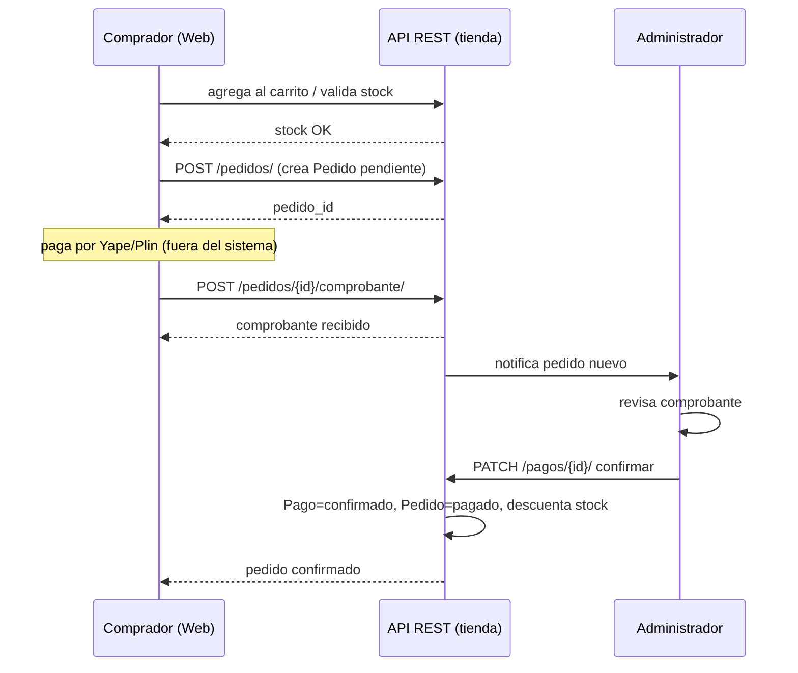

# Diagramas del proyecto — Wawa Pacocha (código Mermaid)

> Pégalos en https://mermaid.live para verlos y exportarlos como **PNG** o **SVG** (alta resolución).
> Luego se pueden insertar en los entregables E1 y E2.

---

## ENTREGABLE 2 — Diagrama Entidad–Relación (ER)



---

## ENTREGABLE 1 — Arquitectura (estilo C4: contexto + contenedores)



---

## ENTREGABLE 1 — Casos de Uso



---

## ENTREGABLE 1 — Clases (Módulo Ganadería)



---

## ENTREGABLE 1 — Clases (Módulo Tienda)



---

## ENTREGABLE 1 — Secuencia: Sincronización Offline



---

## ENTREGABLE 1 — Secuencia: Compra y Pago Manual



---

### Cómo exportarlos como imagen
1. Entra a https://mermaid.live
2. Pega un bloque de código (sin los ``` de arriba y abajo).
3. Menú **Actions → PNG** (o SVG) para descargar la imagen en alta resolución.
4. Esa imagen se puede insertar en el entregado correspondiente.
