# Diagramas del proyecto — Wawa Pacocha (código Mermaid)

> Pégalos en https://mermaid.live para verlos y exportarlos como **PNG** o **SVG** (alta resolución).
> Luego se pueden insertar en los entregables E1 y E2.
>
> Actualizados según el MVP real: backend Django REST, app Flutter (offline-first), tienda Next.js, MySQL 8.

---

## ENTREGABLE 2 — Diagrama Entidad–Relación (ER)

> Modelo de datos completo (31 tablas) del sistema Wawa Pacocha.

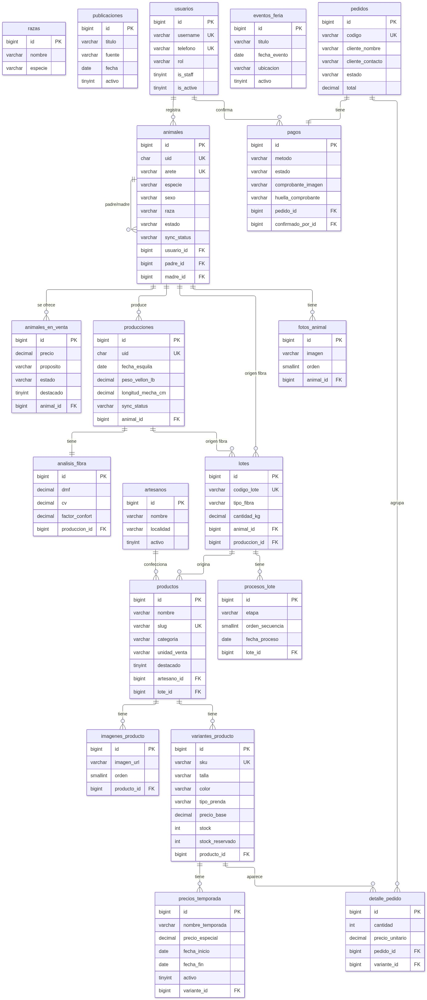

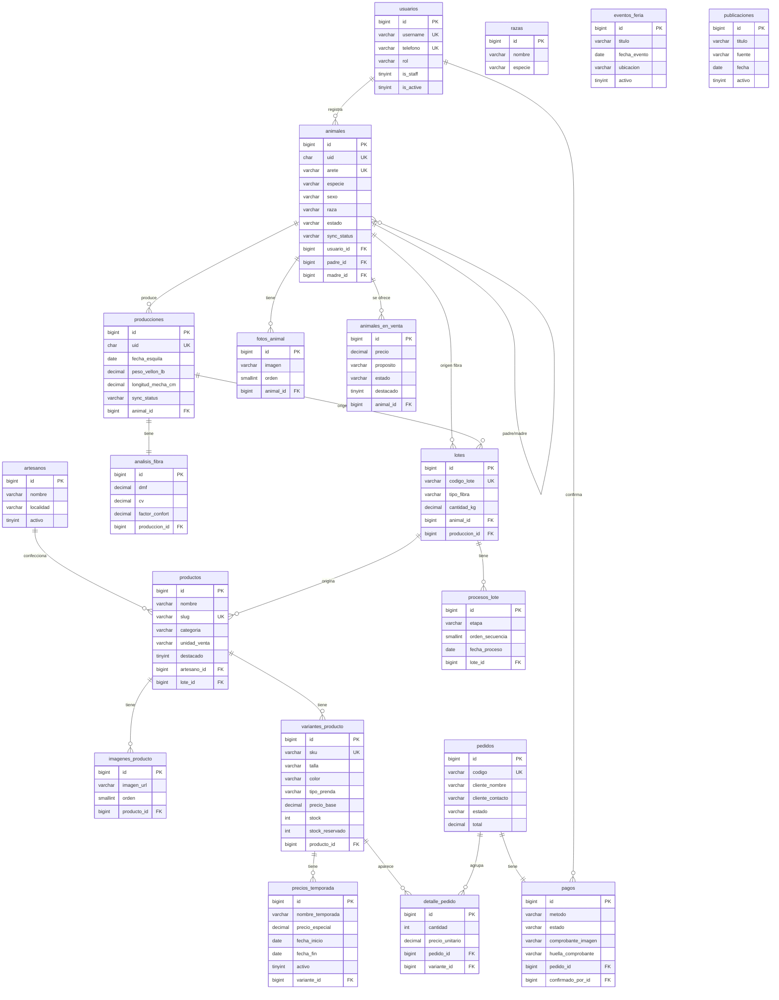

---

## ENTREGABLE 1 — Arquitectura (estilo C4: contexto + contenedores)

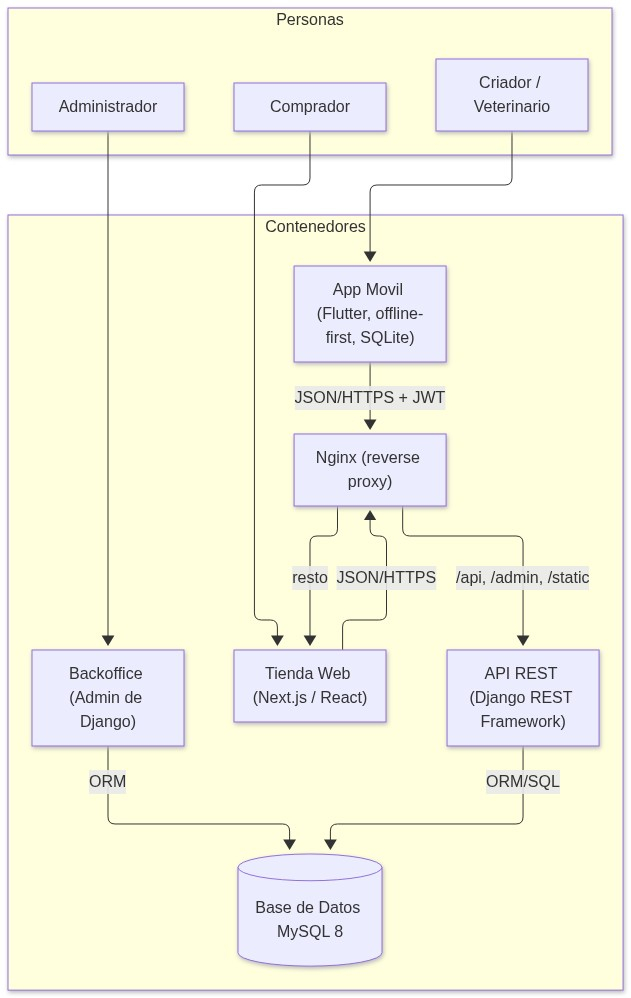

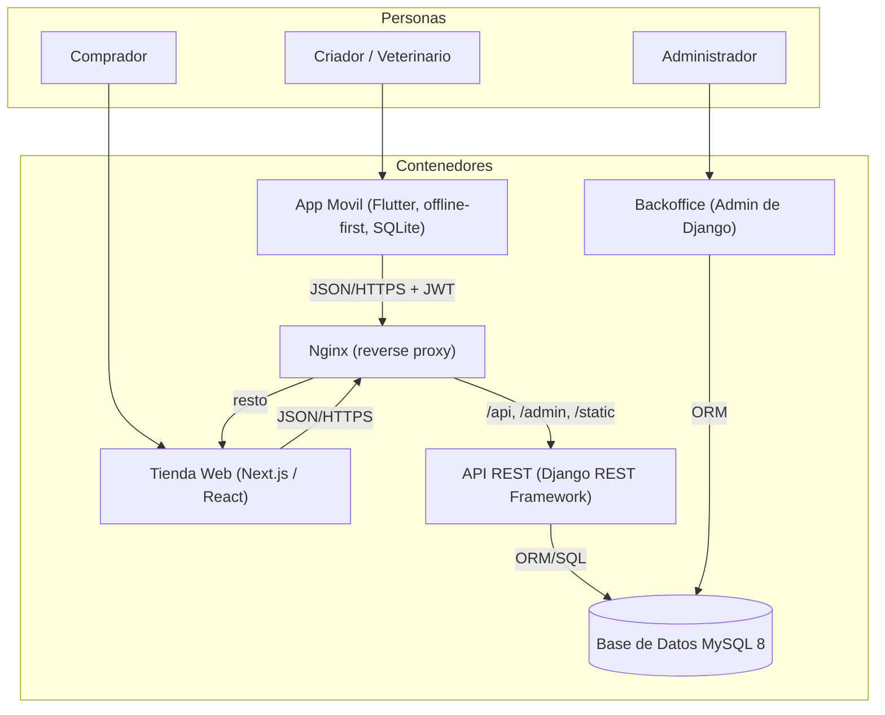

---

## ENTREGABLE 1 — Casos de Uso

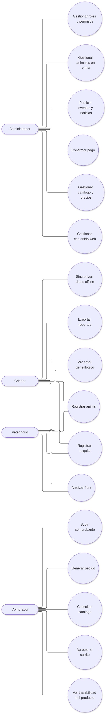

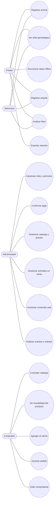

---

## ENTREGABLE 1 — Clases (Módulo Ganadería)

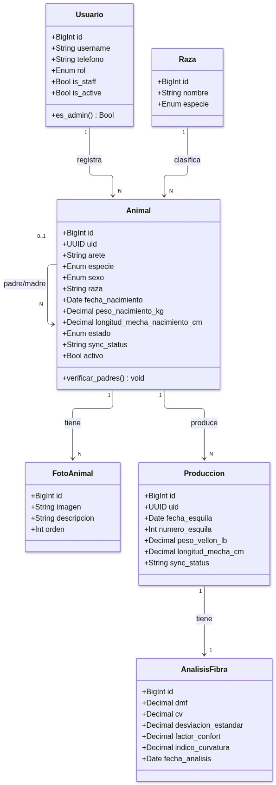

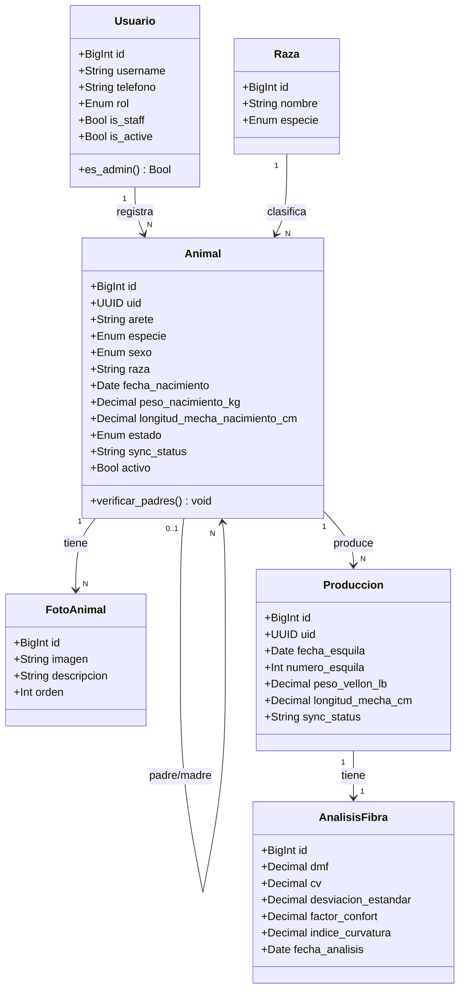

---

## ENTREGABLE 1 — Clases (Módulo Tienda)

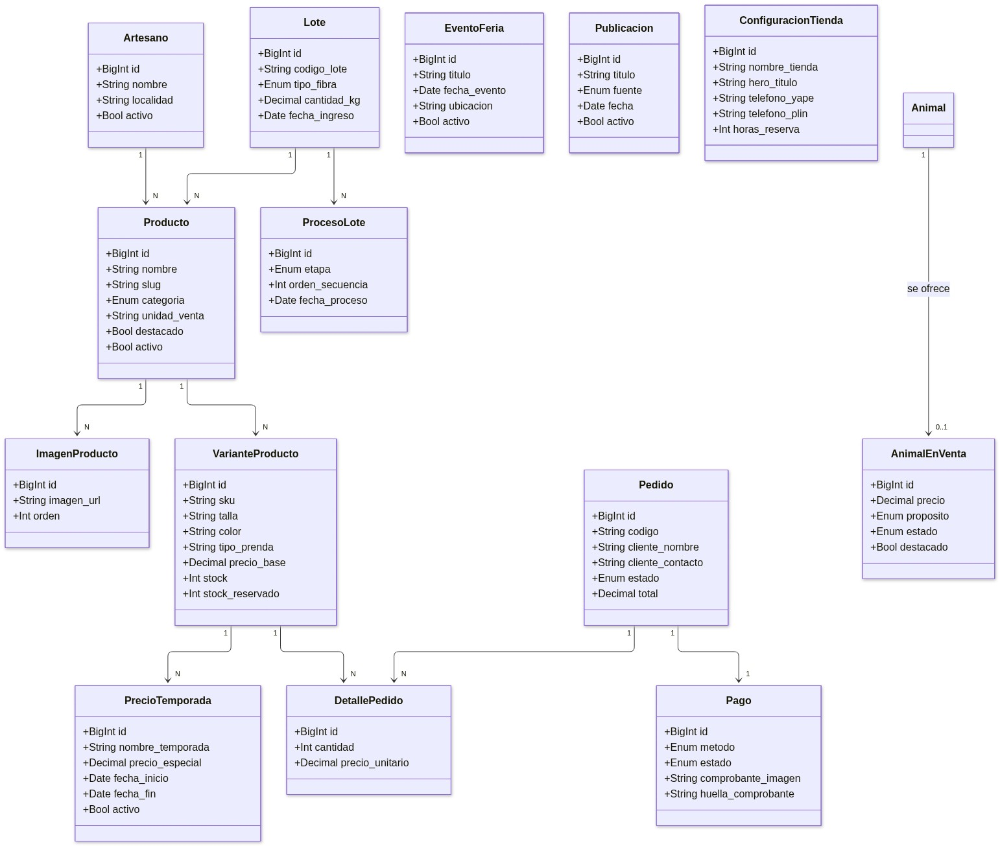

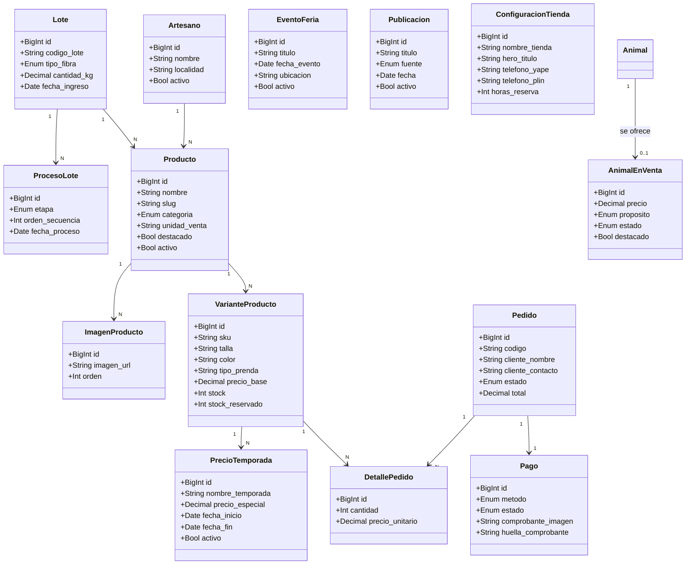

---

## ENTREGABLE 1 — Secuencia: Sincronización Offline

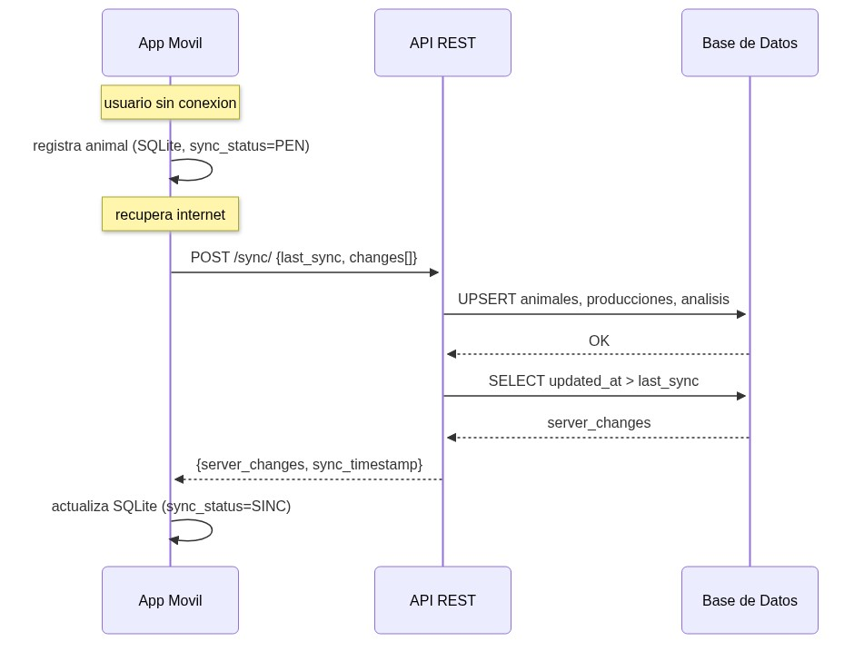

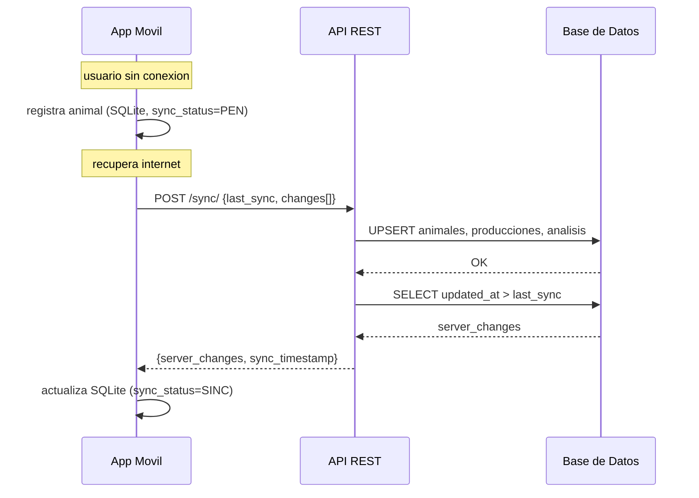

---

## ENTREGABLE 1 — Secuencia: Compra y Pago Manual

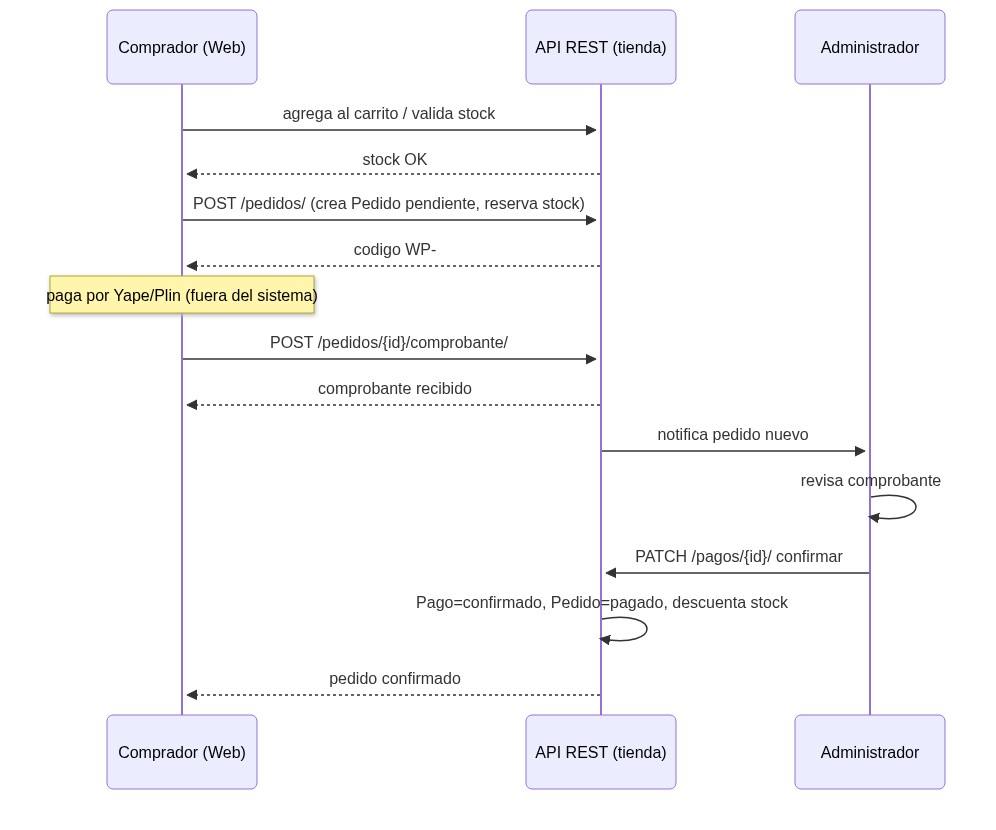

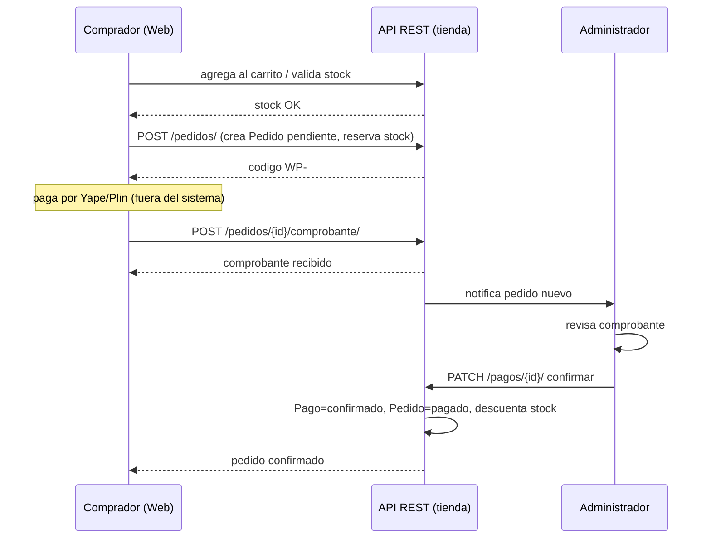

---

## ENTREGABLE 1 — Secuencia: Trazabilidad del Producto

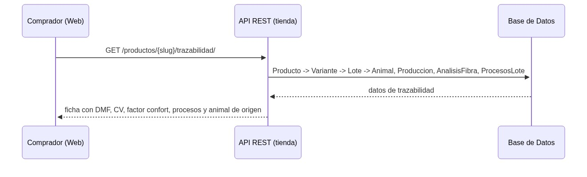

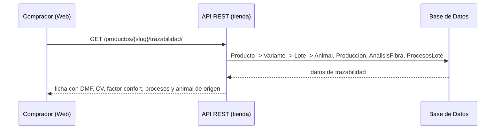

---

### Cómo exportarlos como imagen
1. Entra a https://mermaid.live
2. Pega un bloque de código (sin los ``` de arriba y abajo).
3. Menú **Actions → PNG** (o SVG) para descargar la imagen en alta resolución.
4. Esa imagen se puede insertar en el entregado correspondiente.